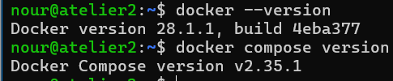
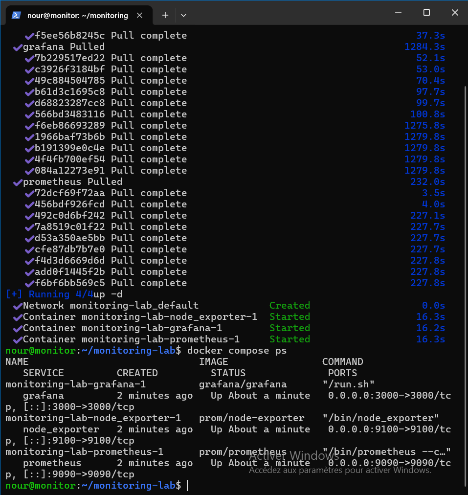
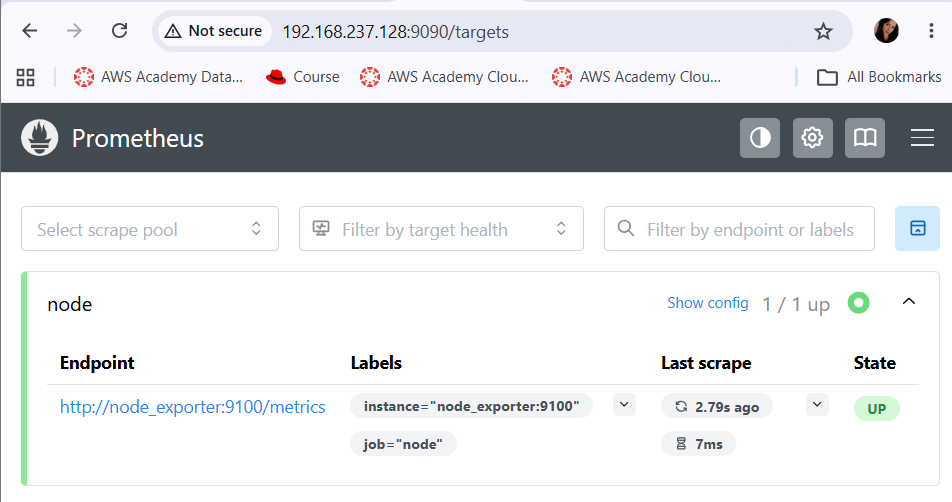
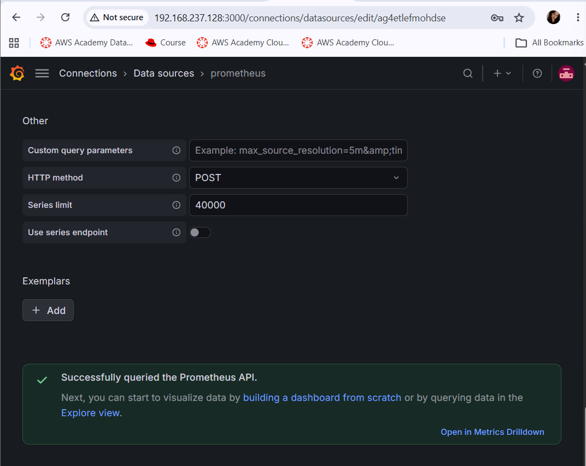
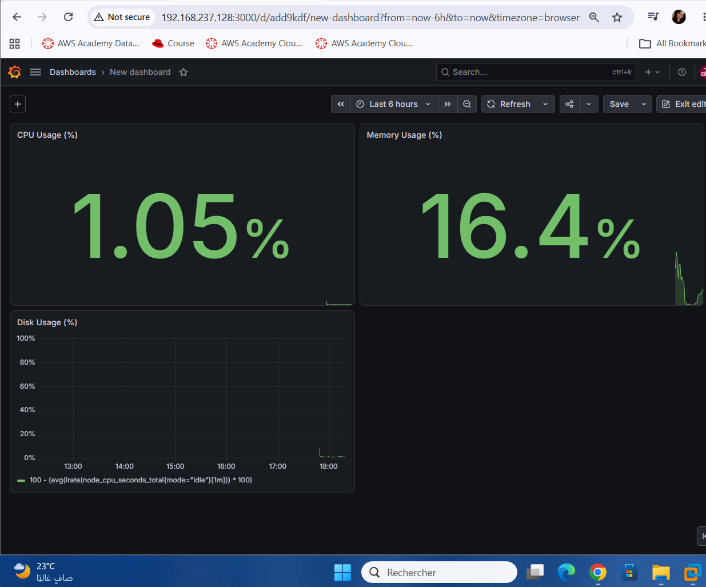
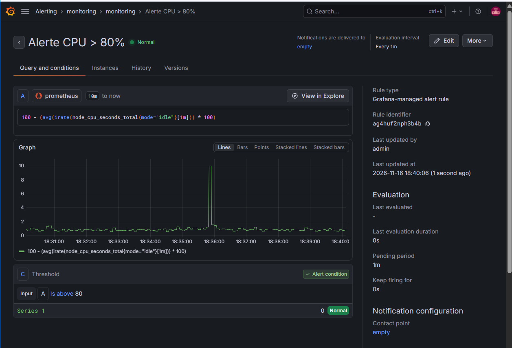

# TP : Introduction au Monitoring en DevOps

**Master DevOps et Cloud Computing, 2e année, ISET Tozeur, Disponibilité des Infrastructures**
**Auteur :** Nour Kidoudi

## Objectifs

- Comprendre le rôle du monitoring dans la chaîne DevOps.
- Installer un outil open source de supervision (Prometheus).
- Construire un premier tableau de bord avec Grafana.
- Interpréter les indicateurs de performance collectés.

## Environnement

- Machine virtuelle Ubuntu 22.04 (`monitor`)
- Docker Engine + Docker Compose
- Prometheus, Node Exporter, Grafana (via Docker Compose)

---

## 1. Pourquoi le monitoring est essentiel en DevOps

Le monitoring fournit une visibilité continue sur l'état des infrastructures et des applications. Il permet de détecter rapidement les incidents grâce aux alertes, de réduire le temps de résolution, de mesurer l'impact des déploiements et d'anticiper les problèmes de capacité. Il ferme la boucle de la chaîne DevOps : les métriques collectées en production alimentent l'amélioration continue du code et de l'infrastructure.

---

## 2. Installation de Docker et Docker Compose

Installation de Docker Engine et du plugin Compose depuis le dépôt officiel, puis vérification :

```bash
docker --version
docker compose version
```



*Docker et Docker Compose sont correctement installés.*

---

## 3. Mise en place de Prometheus, Node Exporter et Grafana

### Fichier `docker-compose.yml`

```yaml
services:
  prometheus:
    image: prom/prometheus
    ports:
      - "9090:9090"
    volumes:
      - ./prometheus.yml:/etc/prometheus/prometheus.yml

  node_exporter:
    image: prom/node-exporter
    ports:
      - "9100:9100"

  grafana:
    image: grafana/grafana
    ports:
      - "3000:3000"
```

### Fichier `prometheus.yml`

```yaml
global:
  scrape_interval: 5s

scrape_configs:
  - job_name: 'node'
    static_configs:
      - targets: ['node_exporter:9100']
```

### Démarrage des conteneurs

```bash
docker compose up -d
```



*Les trois conteneurs (prometheus, node_exporter, grafana) sont démarrés.*

### Vérification des cibles Prometheus

Page `http://localhost:9090/targets` :



*La cible `node_exporter:9100` est à l'état **UP** : Prometheus collecte bien les métriques système.*

---

## 4. Configuration de Grafana

### Source de données

Dans Grafana (`http://localhost:3000`), **Connections → Data sources → Add data source → Prometheus**, avec l'URL `http://prometheus:9090`.

On utilise le nom du service `prometheus` et non `localhost`, car Grafana s'exécute dans un conteneur et communique avec Prometheus via le réseau Docker Compose.



*Le test **Save & test** confirme que la source de données fonctionne.*

---

## 5. Dashboard : 3 panneaux

| Panneau | Requête PromQL |
|---|---|
| CPU Usage (%) | `100 - (avg by (instance)(irate(node_cpu_seconds_total{mode="idle"}[5m])) * 100)` |
| Memory Usage (%) | `((node_memory_MemTotal_bytes - node_memory_MemAvailable_bytes) / node_memory_MemTotal_bytes) * 100` |
| Disk Usage (%) | `100 - (node_filesystem_free_bytes{mountpoint="/"} / node_filesystem_size_bytes{mountpoint="/"} * 100)` |



### Explication des indicateurs

- **CPU Usage (%)** : pourcentage de temps pendant lequel le processeur est occupé (100 % moins le temps d'inactivité). Un pic prolongé indique une surcharge de la machine.
- **Memory Usage (%)** : part de la RAM utilisée, calculée à partir de la mémoire *disponible*. Proche de 100 %, le système risque de swapper ou de tuer des processus (OOM).
- **Disk Usage (%)** : taux d'occupation de la partition racine `/`. Il faut le surveiller pour éviter la saturation du disque, qui peut bloquer les services.

---

## 6. Alerte CPU > 80 %

Création d'une règle d'alerte dans **Alerting → Alert rules** :

- **Requête** : utilisation CPU (%)
- **Condition** : `IS ABOVE 80`
- **Période d'attente (pending)** : 1 minute
- **Intervalle d'évaluation** : 1 minute



*La règle se déclenche si le CPU dépasse 80 % pendant 1 minute. La notification (email, Slack, webhook) est facultative dans ce TP.*

---

## 7. Conclusion

Ce TP a permis de mettre en place une chaîne de monitoring complète : collecte des métriques système (Node Exporter), stockage et interrogation (Prometheus), visualisation et alerting (Grafana). Le tout est déployé de façon reproductible avec Docker Compose, ce qui s'inscrit dans la démarche DevOps d'infrastructure as code.
